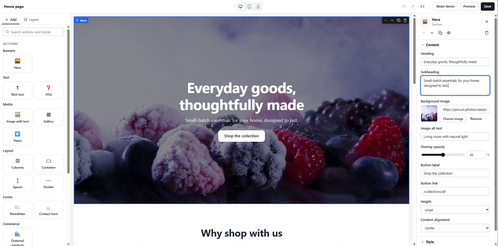

# dnd-web-builder



A framework-agnostic, **SSR-safe** drag & drop page builder.

- **Core** (`dnd-web-builder`): a JSON document model, a plugin registry, and a pure _string_ renderer, plus HTML safety helpers. It never touches `document` or `window`, so it runs in Node, edge runtimes and React Server Components.
- **Editor** (`dnd-web-builder/editor`): a browser-only visual editor built on the same registry and renderer. It has undo/redo, layers, drag & drop, device preview and data fetching.
- **Styles**: `dnd-web-builder/style.css` has neutral content styles built on CSS custom properties and container queries. `dnd-web-builder/editor.css` has the editor chrome.

## Install

```bash
npm install dnd-web-builder
# or link a local checkout
npm install file:../path/to/web-builder
```

The package ships ESM only and has no runtime dependencies. If you consume it from source via `file:`, build it once with `npm run build`, which produces `dist/`.

## Core usage (server-side rendering)

```ts
import {
  createRegistry,
  corePlugin,
  normalizeDocument,
  collectDataRequests,
  renderDocument,
} from "dnd-web-builder";
import "dnd-web-builder/style.css"; // or link dist/style.css

const registry = createRegistry(corePlugin /*, myPlugin */);

// Accepts v2, legacy v1, null or garbage, and always returns a valid v2 document.
const doc = normalizeDocument(await loadPageJson());

// 1. Ask the sections what remote data they need (de-duplicated by key, hidden sections skipped).
const requests = collectDataRequests(doc, registry, { store });
// 2. Resolve them however you like (DB, API, cache…), keyed by request.key.
const data = Object.fromEntries(
  await Promise.all(requests.map(async (r) => [r.key, await resolve(r)])),
);
// 3. Render to an HTML string.
const html = renderDocument(doc, registry, { data, globals: { store } });
```

Output contract (themes and the editor rely on it):

```html
<div class="wb-page">
  <section
    class="wb-section wb-section--hero my-class"
    data-section-id="s_abc"
    data-section-type="hero"
    style="padding-top: 40px"
  >
    …section HTML…
    <div class="wb-blocks" data-blocks-for="s_abc">
      <div
        class="wb-block wb-block--button"
        data-block-id="b_xyz"
        data-block-type="button"
      >
        …
      </div>
    </div>
  </section>
</div>
```

- Hidden sections and unknown types render nothing live. In editor mode they render as a placeholder.
- A section or block that throws is logged and skipped, so the rest of the page still renders.
- `customCss` is emitted as a scoped `<style>[data-section-id="…"] { … }</style>`. Nested rules work through CSS nesting.

### Document model

```ts
interface PageDocument {
  version: 2;
  order: string[];
  sections: Record<string, SectionNode>;
}
interface SectionNode {
  id: string;
  type: string;
  settings: Settings;
  blocks: BlockNode[];
  hidden?: boolean;
}
interface BlockNode {
  id: string;
  type: string;
  settings: Settings;
}
```

Helpers: `createEmptyDocument()`, `normalizeDocument(input)`, `isEmptyDocument(doc)`, `createId("s" | "b")`.

### HTML helpers

`escapeHtml`, `escapeAttr`, `safeUrl(url, fallback = "#")`, `sanitizeHtml(html)`, `jsonForScript(value)`, `classNames(...)`, `parseList(value)`.

`sanitizeHtml` is a DOM-free allowlist sanitizer. It allows `p br b strong i em u a(href,target,rel) ul ol li h2 h3 h4 blockquote span`. It strips everything else, including `on*`, `style` and unsafe URLs, removes `<script>`/`<style>` with their content, and drops comments. Its output is always well-formed.

## Editor usage (browser)

```ts
import { createRegistry, corePlugin } from "dnd-web-builder";
import { createEditor } from "dnd-web-builder/editor";
import "dnd-web-builder/style.css";
import "dnd-web-builder/editor.css";

const editor = createEditor({
  container: document.getElementById("editor")!, // mounts full-size inside
  registry: createRegistry(corePlugin),
  document: savedJson, // anything; it is normalized
  template: "home", // filters sections by `templates`
  title: "Home page",
  globals: { store },
  dataProvider: async (requests) => fetchData(requests), // results are cached by key
  pickers: {
    image: () => openMediaLibrary(), // → URL | null
    product: () => openProductPicker(), // → handle | null
  },
  toolbarActions: [
    {
      id: "save",
      label: "Save",
      primary: true,
      onClick: async (ed) => {
        await save(ed.getDocument());
        ed.markSaved();
      },
    },
  ],
});

editor.on("change", ({ document, dirty }) => {
  /* autosave, dirty indicator… */
});
editor.on("select", ({ kind, id }) => {});

editor.addSection("hero", 0);
editor.undo();
editor.setDevice("mobile");
editor.destroy(); // removes DOM and every listener (document/window too)
```

The full API is `getDocument`, `setDocument(doc, { resetHistory })`, `markSaved`, `dirty`, `undo`/`redo`/`canUndo`/`canRedo`, `select`, `addSection`, `addBlock`, `moveSection`, `moveBlock`, `duplicate`, `remove`, `toggleHidden`, `updateSettings`, `setDevice`, `refreshData`, `on` and `destroy`. Move indices are the item's **final** index.

UX overview:

- **Top bar**: title, device switcher (100% / 768 / 390 px), undo/redo, a JSON viewer and your actions.
- **Add tab**: searchable sections grouped by category. Click to append, or drag onto the canvas. Blocks can be dragged into sections that allow them.
- **Layers tab**: a section → block tree. Click to select, drag to reorder or move, and use the eye to hide.
- **Canvas**: hover and selection outlines, plus a floating mini toolbar (drag handle, up, down, duplicate, delete). Links and forms never navigate.
- **Settings panel**: fields are grouped Content / Style / Advanced. The panel is never rebuilt while you type, and only the affected section is re-rendered.
- **Keyboard**: Ctrl/Cmd+Z, Ctrl/Cmd+Shift+Z or Ctrl+Y, Delete/Backspace, Escape, Ctrl/Cmd+D.

## Writing a plugin

Definitions return **inner HTML strings**. The renderer adds the `<section>` / block wrappers, styles and data attributes. Escape every setting.

```ts
import {
  escapeHtml,
  escapeAttr,
  safeUrl,
  styleFields,
  advancedFields,
  type Plugin,
} from "dnd-web-builder";

export const commercePlugin: Plugin = {
  name: "commerce",
  sections: [
    {
      type: "featured-collection",
      label: "Featured collection",
      icon: "🛍️",
      category: "Commerce",
      allowedBlocks: "none",
      schema: [
        { key: "heading", label: "Heading", type: "text", default: "Featured" },
        { key: "collection", label: "Collection", type: "collection" },
        {
          key: "limit",
          label: "Products",
          type: "range",
          min: 2,
          max: 12,
          default: 4,
        },
        ...styleFields,
        ...advancedFields,
      ],
      // Declare remote data; the host resolves it before rendering (SSR) or via dataProvider (editor).
      data: (section) => [
        {
          key: `collection:${section.settings.collection}`,
          type: "collection",
          params: {
            handle: section.settings.collection,
            limit: section.settings.limit,
          },
        },
      ],
      render(section, ctx) {
        const products = (ctx.data[
          `collection:${section.settings.collection}`
        ] ?? []) as { title: string; url: string }[];
        return `<div class="wb-container">
          <h2>${escapeHtml(section.settings.heading)}</h2>
          <ul>${products.map((p) => `<li><a href="${escapeAttr(safeUrl(p.url))}">${escapeHtml(p.title)}</a></li>`).join("")}</ul>
        </div>`;
      },
    },
  ],
  blocks: [
    {
      type: "badge",
      label: "Badge",
      schema: [{ key: "text", label: "Text", type: "text" }],
      render: (b) =>
        `<span class="badge">${escapeHtml(b.settings.text)}</span>`,
    },
  ],
};
```

Sections can also set `maxBlocks`, `presetBlocks` (added when inserted from the chooser), `templates` (e.g. `["product"]`) and `defaults`. Settings resolve as schema defaults < definition `defaults` < node settings. A section that accepts blocks renders them with `ctx.renderBlocks(section)`.

Registries are plain instances (`createRegistry(...plugins)` or `new Registry().use(plugin)`). There is no global state. A duplicate type logs a warning and is ignored.

### Core plugin

Sections: `hero`, `rich-text`, `image-with-text`, `columns`, `container`, `gallery`, `faq`, `newsletter` (form `data-wb-form="newsletter"`), `contact-form` (form `data-wb-form="contact"`), `video` (YouTube / Vimeo / mp4), `spacer`, `divider`.

Blocks: `heading`, `text`, `image`, `button`, `quote`, `video`, `spacer`, `icon-text`.

## Field types

| type                    | stores                  | editor control                                                           |
| ----------------------- | ----------------------- | ------------------------------------------------------------------------ |
| `text`, `url`           | string                  | text input                                                               |
| `textarea`              | string                  | textarea                                                                 |
| `richtext`              | sanitized HTML          | contenteditable with bold / italic / link / bullet list                  |
| `number`                | number                  | number input (empty → unset)                                             |
| `range`                 | number                  | slider + number (`min`/`max`/`step`/`unit`)                              |
| `boolean`               | boolean                 | switch                                                                   |
| `select`                | string                  | select (`options`: strings or `{label, value}`)                          |
| `color`                 | CSS color string        | swatch + text, clearable                                                 |
| `image`                 | URL string              | preview + URL input, or `pickers.image`                                  |
| `product`, `collection` | handle string           | text input, or `pickers.product` / `pickers.collection`                  |
| `list`                  | newline-separated lines | monospace textarea; read with `parseList()` → `string[][]` split on `\|` |

Common options: `group` (`content` / `style` / `advanced`), `default`, `placeholder`, `help`, `visibleIf(settings)`.

`styleFields` adds padding, margin, background and text color, alignment, content max width and corner radius. `styleAttr(settings)` turns them into a validated inline style. `advancedFields` adds `cssClass` and `customCss`.

## Theming

`style.css` is neutral and driven by custom properties on `.wb-page`:

```css
.wb-page {
  --wb-color-primary: #0f766e;
  --wb-color-text: #1f2937;
  --wb-color-bg: #fff;
  --wb-color-accent: #f0fdfa;
  --wb-color-border: #e5e7eb;
  --wb-radius: 4px;
  --wb-font-heading: "Fraunces", serif;
  --wb-font-body: "Inter", sans-serif;
  --wb-container: 1280px;
}
```

Layouts respond to **container queries** on `.wb-page` (`container-type: inline-size`), not media queries. That keeps the editor's device preview exact. Themes should do the same:

```css
@container wb-page (min-width: 900px) { .my-section { … } }
```

## Development

```bash
npm install
npm run dev         # demo playground (src/demo, saves to localStorage)
npm run typecheck   # strict TypeScript
npm test            # vitest: core in Node (SSR proof), editor smoke tests in happy-dom
npm run build       # dist/: index.js, editor.js, *.d.ts, style.css, editor.css
npm run build:demo  # gh-pages demo → dist-demo/
```
